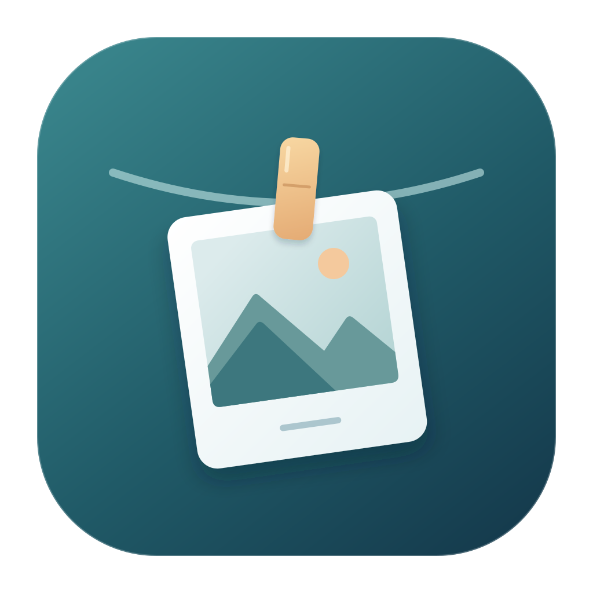
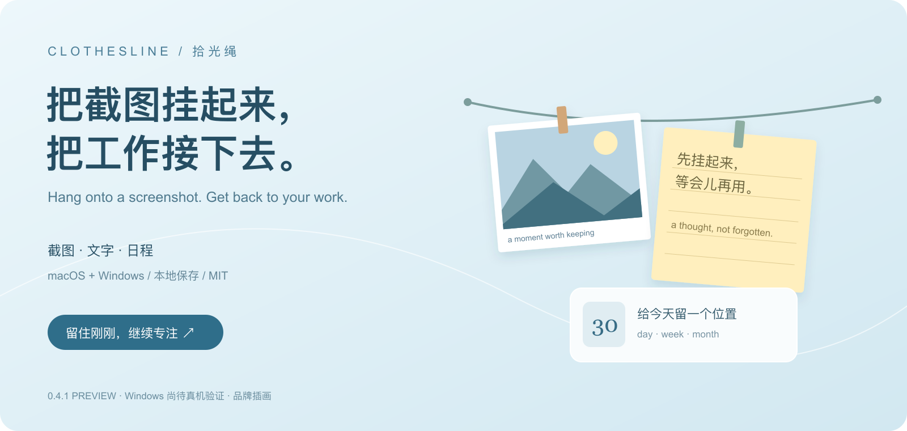
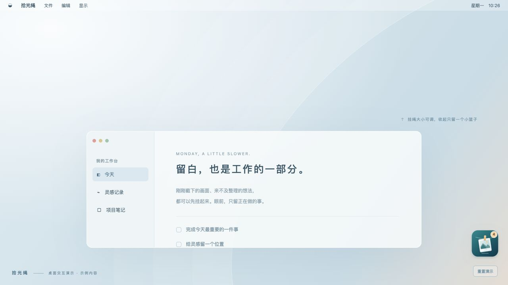

<h1 align="center">拾光绳 · Clothesline</h1>

<strong>把截图挂起来，把工作接下去。</strong> Hang onto a screenshot. Get back to your work.

macOS · Windows · Go + 系统 WebView · 本地保存 · MIT

<a href="docs/i18n/README.en.md">English</a> · <a href="docs/i18n/README.zh-TW.md">繁體中文</a> · 简体中文 · <a href="docs/i18n/README.ja.md">日本語</a>

<a href="https://github.com/dongxinsss/clothesline/releases"><strong>下载 0.4.1 预览版</strong></a> · <a href="docs/guides/guide.zh-CN.md">使用教程</a> · <a href="https://github.com/dongxinsss/clothesline/issues">反馈问题</a> · <a href="docs/promotion/SHARE.md">分享素材</a>

刚截的图、临时要用的文字、今天要做的事，都可以先挂在桌面的一条绳上。用完收进小篮子，需要时再展开。

## 随手收好，等会儿再用

| 你想做的事 | 拾光绳怎么帮你 |
| --- | --- |
| 临时接住一张截图 | 自动收集剪贴板里的新图片；微信、钉钉或系统截图只要复制成图片即可 |
| 留下一句文字 | 手动粘贴文字或新建便签，普通复制的文字不会被自动记录 |
| 把素材送到下一步 | 卡片可拖出到支持的应用，也可复制或导出；具体目标应用仍需实测 |
| 找回之前挂过的内容 | 历史记录持久保存，支持搜索、预览、重新挂上和手动永久删除 |
| 看今天、本周、本月安排 | 「文字」旁的「日程」可创建、编辑、完成当天或跨天安排 |
| 尽量少挡住工作 | 默认约占可用屏幕高度 20%；收起为 80×80 逻辑像素的小篮子 |

使用 Go 和系统自带 WebView，不打包 Chromium。实际内存仍包含系统 WebView 进程；这里不承诺未经测量的内存数字。运行时无需账号，不包含云同步或统计上报。

## 看看它怎么用

| 字号与主题 | 日程 |
| --- | --- |
|  |  |

| 历史记录 | 小篮子 |
| --- | --- |
|  |  |

以上为真实前端的**浏览器交互演示截图**，仅含新建的示例数据。系统截图、托盘和跨应用拖放需要桌面版；演示不等同于原生功能验收。应用界面目前为中文，四语支持指使用文档。

## 一分钟开始

1. 到 [Releases](https://github.com/dongxinsss/clothesline/releases) 下载并解压对应系统的包。macOS 打开 `拾光绳.app`；Windows 运行 `Clothesline.exe`。
2. 在偏好设置里确认「自动收集截图」是否开启，复制一张不含隐私的截图，看看它出现在绳上。
3. 点「新建文字」写便签，或在挂绳上按 `⌘/Ctrl+V` 粘贴图片、文字。
4. Esc 收进篮子；篮子可以拖动，点击展开。Windows 保留右下角托盘入口，不显示任务栏按钮。
5. 「历史记录」找回旧内容；「日程」管理当天、本周或本月安排。

**四语教程：** [简体中文](docs/guides/guide.zh-CN.md) · [繁體中文](docs/guides/guide.zh-TW.md) · [English](docs/guides/guide.en.md) · [日本語](docs/guides/guide.ja.md)

## 系统与当前状态

| 平台 | 安装包与要求 | 验证情况 |
| --- | --- | --- |
| macOS | 12.0+，Apple Silicon / Intel 通用包 | 有本机测试，具体范围见验证记录 |
| Windows | 10/11 x64，需要 WebView2 Runtime | 已交叉编译，尚未 Windows 真机验证 |

当前版本 **0.4.1 预览版**。macOS 使用临时签名，尚未 Apple 公证；Windows 未代码签名。跨应用图片拖放、混合 DPI 和多屏布局的兼容性仍需要更多真机反馈。日程没有提醒或云日历同步；暂不含 OCR、标注、开机启动和多屏选屏。

### 滚动截图

「截图」旁的「滚动截图」先框选内容，再回到目标应用向下滚动；采集器尝试自动匹配重叠并拼接，也可手动补采。它不会替你滚动页面，固定导航、重复图案或滚动过快可能导致匹配失败。完整步骤和限制见[教程](docs/guides/guide.zh-CN.md#滚动截图)。

## 数据留在哪里

- macOS：`~/Library/Application Support/Clothesline`
- Windows：`%AppData%\Clothesline`
- 更新程序时保留数据目录，历史和设置继续使用。请勿把数据目录、`shelf.json` 或私人截图上传到公开 Issue。

自动收集开关可关闭。截图内容由你决定；来源应用标记为敏感的剪贴板内容会跳过，未标记的图片也可能包含隐私。

## 从源码构建与参与

[构建说明](docs/BUILD.md) · [验证记录](docs/VALIDATION.md) · [贡献指南](CONTRIBUTING.md) · [更新日志](CHANGELOG.md) · [MIT 许可证](LICENSE) · [第三方许可证](docs/THIRD-PARTY-NOTICES.txt)

欢迎用可复现的示例报告问题，帮忙翻译文档，或测试 Windows / 不同聊天应用的拖放。如果它适合你的工作流，点一个 **Star**，或分享给常用截图的朋友。
