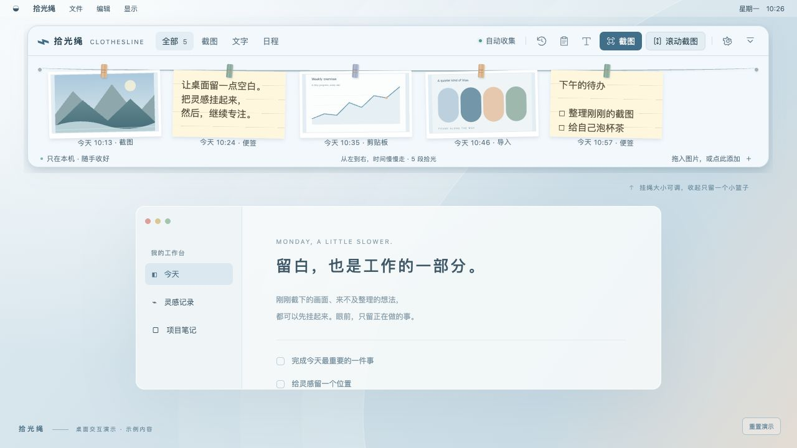
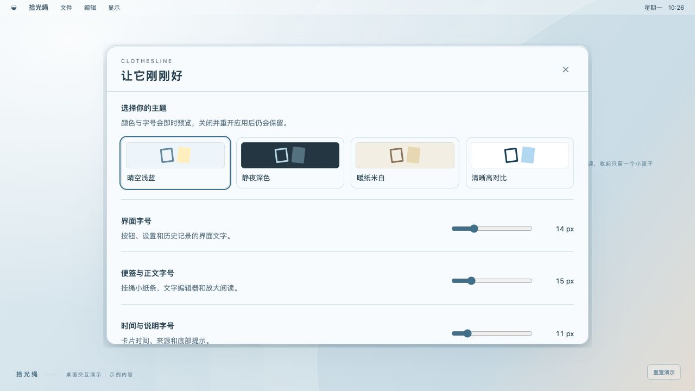
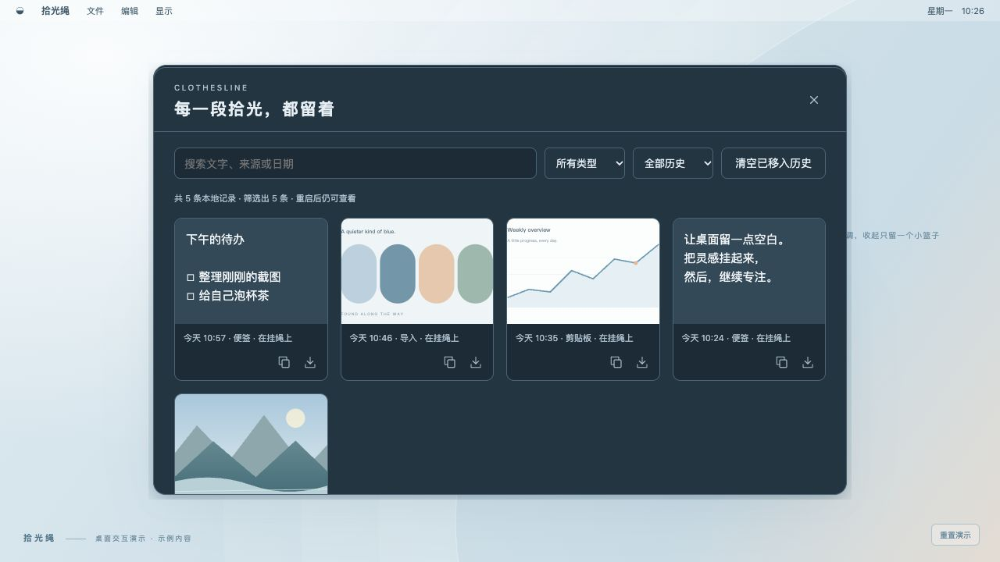
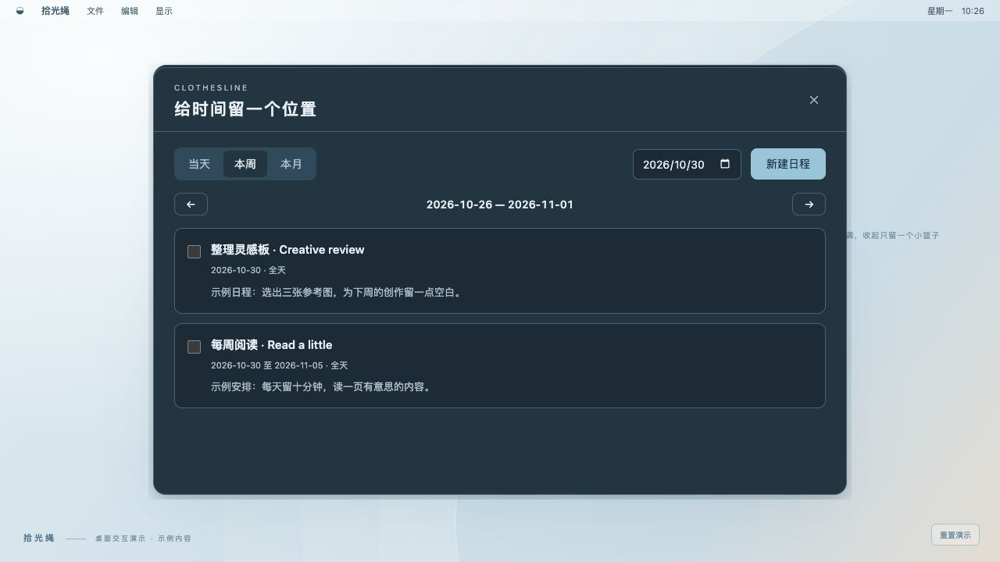

# Clothesline user guide

[Home](../i18n/README.en.md) · [简体中文](guide.zh-CN.md) · [繁體中文](guide.zh-TW.md) · [日本語](guide.ja.md)

## Install or update

Download the matching 0.4.1 archive from the repository's Releases and extract it first. On macOS 12+, open `拾光绳.app`; you may move it to Applications. On Windows 10/11 x64, run `Clothesline.exe`. Microsoft WebView2 Runtime is required.

This preview is not publicly code-signed/notarized. Download only from a source you trust and follow the OS's normal approval flow; do not disable system security globally. For macOS capture, follow the Screen Recording permission prompt under Privacy & Security and restart the app if requested.

For updates, quit the old process, replace the application file, and reopen. Keep the data directory to preserve your history and settings.

## Find the controls

**全部 / 截图 / 文字** filter all cards / images / text. **日程** opens schedules. The clock button opens history. The right side contains paste, new note, screenshot, scrolling screenshot, settings, and collapse. The UI is currently Chinese; these translations describe the actual labels.

## Collect images and text

1. Enable **自动收集截图** in settings. Take a screenshot in your system tool or another app, then copy its image to the clipboard.
2. For a file-only screenshot, drag it into the shelf or use import. You can also press Cmd/Ctrl+V while the shelf has focus.
3. Ordinary text is never collected automatically. Paste it manually or use **新建文字**. Cmd/Ctrl+Enter saves a note while editing.
4. Cards are ordered by time from left to right. Use the mouse wheel to browse; click to view an image or read the whole note.
5. Card actions copy, export, or move the card to history. An undo notice appears after removal.

Limits: 32 MB / 50 megapixels per image, 20,000 characters per text note, and 1,000 active cards. Exceeding a limit shows an error rather than automatically deleting history.

## Drag to another app

Hold a card and drag it to an application that accepts an image file or plain text. Images are offered as local PNG files. If the target rejects the type, use copy or export. Native outbound drag requires the desktop build, not the browser demo. Windows and individual chat apps still need real-host compatibility testing.

## Fold, move, and reopen

Esc or the collapse button folds the shelf into an 80×80 logical-pixel basket. Drag the basket to move it; click it to reopen. Its position survives expand/collapse and normal restarts. If a monitor disappears, placement is kept in a visible work area.

On Windows the app uses the notification-area tray, possibly inside the hidden-icons section, without an active taskbar button. Remove any manually pinned old shortcut separately. On macOS, a menu-bar entry remains available and Dock visibility is configurable. Use **退出拾光绳** in settings or the tray menu to quit; Cmd+Q also works on macOS.

## Themes, fonts, and idle collapse

Choose blue, dark, paper, or high contrast. UI text can be 12–20px, note text 12–26px, metadata 10–16px, and card width 140–260px. Settings persist.

**无操作后自动收起** controls idle collapse. Choose a preset or 1–86,400 seconds; 0 means never. Editing, captures, and active drags pause the timer. You can change shelf height or resize it at the edges.

## History

The clock opens **历史记录**. Search, filter images/text and record status, preview, copy, or restore cards to the line. Archived records remain after restart. Permanent deletion asks for a second confirmation and removes the record and image files; the app cannot undo it.

If older records appear missing, check the data directory in settings. **导入旧记录** merges an old directory containing `shelf.json` without changing that directory. Back it up first, and never publish private history for debugging.

## Schedules

Open **日程** beside the text filter. Switch between day, week, and month; create an entry with a title, date, optional time, all-day setting, or date range. Edit entries or mark them complete. This is a local schedule list: there are no system notifications, alarms, or cloud calendar sync.

## Scrolling screenshots

1. Open the content to capture, click **滚动截图**, and drag to select its region. Releasing confirms it.
2. Once the small control panel appears, move your mouse back over the target app and scroll down manually with overlapping frames.
3. The sampler tries to stitch new content. If matching fails, scroll back a little. Fixed navigation or repetitive patterns may require a manual overlap percentage and **手动补采**.
4. Click **完成并挂上** to save a long PNG to the shelf, or cancel to discard the session.

The app does not scroll for you. Capture uses the primary screen; keep window position, selection, and resolution unchanged. Limits are 24 megapixels, 32,760px height, and 32 MB per saved image. Complex pages and native Windows capture need more compatibility testing.

## Shortcuts

| Action | macOS | Windows |
| --- | --- | --- |
| Capture region, global | Ctrl+Option+A | Ctrl+Alt+A |
| Scrolling capture, global | Ctrl+Option+S | Ctrl+Alt+S |
| Paste, shelf focused | Cmd+V | Ctrl+V |
| New note, app focused | Cmd+N | Ctrl+N |
| Save note, while editing | Cmd+Enter | Ctrl+Enter |
| Collapse / return | Esc | Esc |

Disable global shortcuts in settings if they conflict with another app. Esc closes the current panel before collapsing.

## Data and troubleshooting

Data is stored in `~/Library/Application Support/Clothesline` on macOS and `%AppData%\Clothesline` on Windows. Quit before backing up the entire directory, including index and images. A previous valid index is also retained during saves.

- **Image not collected:** confirm the source copied image data, not just saved a file, and auto-collection is enabled. Sensitive-marked clipboard content is skipped.
- **Windows cannot launch:** check x64 and WebView2 requirements and the OS's security prompt. Report version and steps without private files.
- **macOS capture fails:** check Screen Recording permissions and restart as instructed.
- **A drop is rejected:** use copy/export and report the target app version and display scaling.
- **Language switch:** the four languages apply to documentation; the app UI remains Chinese.

Version 0.4.1 is a preview. macOS has local checks; Windows is cross-compiled, not real-host verified. See [validation](../VALIDATION.md). All screenshots are browser-demo captures with newly created sample data.
