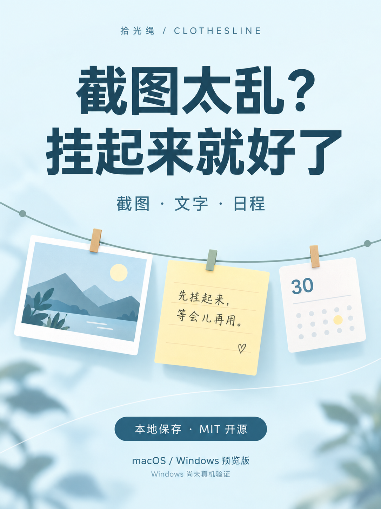

# 小红书宣传素材 · 拾光绳

[项目首页](../../../README.md) · [下载预览版](https://github.com/dongxinsss/clothesline/releases/tag/v0.4.1)

一套可以按顺序上传的 3:4 竖图，以及可直接复制的[文案](小红书文案.txt)。

| 顺序 | 图片 | 内容 |
| --- | --- | --- |
| 01 | [封面](01-封面.png) | 截图太乱？挂起来就好了 |
| 02 | [截图文字](02-截图文字.jpg) | 先挂一下，继续专注 |
| 03 | [日程历史](03-日程历史.jpg) | 今天的安排与之前的记录 |
| 04 | [主题设置](04-主题设置.jpg) | 主题、字号、自动收起 |
| 05 | [试用入口](05-试用入口.jpg) | GitHub 源码、教程与预览包 |

封面为内置 imagegen 生成的原创品牌插画，1086×1448，比例为 3:4。
功能内页由 HTML/CSS 排版并捕获为 1080×1440 JPEG，直接嵌入已有的真实前端浏览器演示截图，图片内容未用生成模型重绘。
界面内容均为新建示例数据。编辑源文件为 [posters.html](posters.html)，从项目根目录启动本地服务器后，访问 `docs/promotion/xiaohongshu/posters.html?page=2`（page 可选 2–5）。按 1080×1440 画布导出完整页面。

封面使用内置图像工具，未使用 CLI/API fallback；最终提示词记录于 [PROMPTS.md](PROMPTS.md)。
Jev 仅对宣传语的证据匹配和目标受众做分类；未接收用户记录、截图、源码或凭证。

发布时建议保留预览版说明：macOS 有本机测试；Windows 仅完成交叉编译、尚未真机验证。四语支持指文档，应用界面目前为中文。日程不含提醒或云同步。

素材按仓库 MIT 许可证提供；使用时也请保留必要的测试范围说明。
